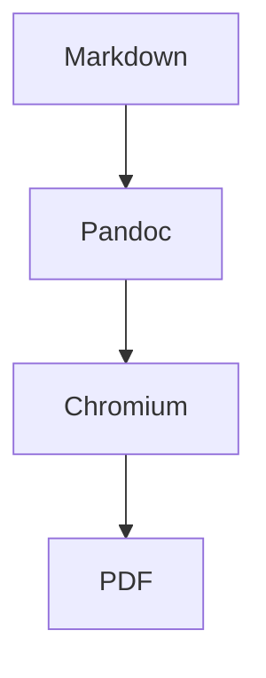
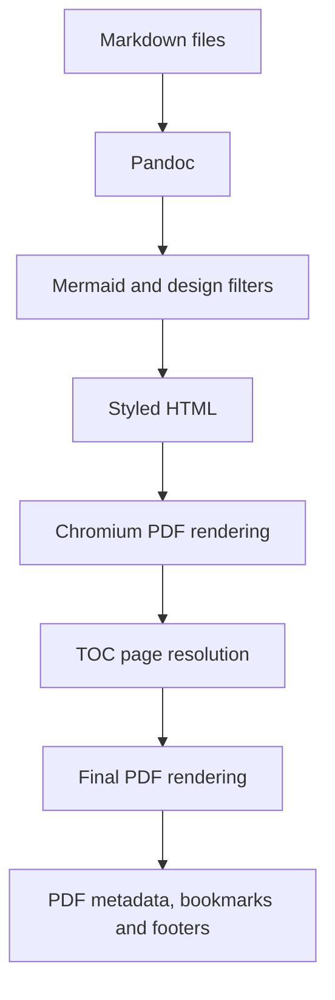

# md2pdf

Convert GitHub-flavored Markdown into clean, readable PDFs. Designed for technical documentation, architecture diagrams and reports.

Built with Pandoc, Chromium and Mermaid, packaged as a Nix flake. No separate tool installations or configuration files are required. Rendering runs locally and works offline once the Nix dependencies are available.

## Usage

Run from a local checkout:

```bash
nix run . -- document.md
```

Or run directly from the Git repository (replace `<user>` with the repository owner):

```bash
nix run 'git+ssh://git@dkgiteap01/<user>/md2pdf' -- document.md
```

The PDF is saved next to the Markdown file unless an output path is specified.

### Combine multiple files

```bash
nix run . -- docs/*.md -o documentation.pdf
```

Files are combined in argument order, with a shared cover page, table of contents, PDF bookmarks and continuous page numbering. Use `-o` when combining multiple files.

## Features

- Four built-in themes with packaged Inter and JetBrains Mono fonts
- GitHub-flavored Markdown, syntax highlighting and GitHub alerts
- Automatic Mermaid rendering with theme-aware colours and adaptive SVG sizing
- Smart pagination, compact tables and heading-aware page breaks
- Clickable table of contents with page numbers and hierarchical PDF bookmarks
- Automatic document titles, cover pages and footers
- Multi-file input, optional section numbering and embedded PDF metadata
- Reproducible Nix packaging and local rendering

## Themes

| Theme | Description | Example PDF |
| --- | --- | --- |
| `technical` | Modern technical documentation (default) | [Preview](assets/previews/technical.pdf) |
| `academic` | Serif typography for reports | [Preview](assets/previews/academic.pdf) |
| `professional` | Corporate and internal documentation | [Preview](assets/previews/professional.pdf) |
| `minimal` | Clean, monochrome layout | [Preview](assets/previews/minimal.pdf) |

```bash
nix run . -- examples/showcase.md --theme academic
```

Generate all four examples:

```bash
for theme in technical academic professional minimal; do
    nix run . -- examples/showcase.md \
        --theme "$theme" \
        -o "assets/previews/$theme.pdf"
done
```

## Command-line options

| Option | Description |
| --- | --- |
| `-o`, `--output FILE` | Set the output PDF path |
| `--theme THEME` | Select a document theme |
| `--pagination MODE` | Select a pagination mode |
| `--cover` | Enable the cover page |
| `--no-cover` | Disable the cover page |
| `--no-toc` | Omit the table of contents |
| `--no-footer` | Omit the footer and page numbers |
| `--number-sections` | Enable automatic section numbering |
| `--metadata-file FILE` | Load optional Pandoc YAML metadata |
| `-h`, `--help` | Show usage |

### Pagination

| Mode | Behaviour |
| --- | --- |
| `smart` (default) | Start H1 headings on new pages and keep short subsections together where possible |
| `chapters` | Start H1 headings on new pages |
| `sections` | Start H1 and H2 headings on new pages, except consecutive H1/H2 headings |
| `flow` | Use natural page breaks |

All modes try to keep headings with their following content. Long sections and tables can still span pages.

## Mermaid

Standard Mermaid code blocks are rendered automatically and embedded as SVG images.

````markdown

````

Diagram sizes are selected automatically from the rendered SVG dimensions. For an individual diagram, use one of the following fenced code languages:

| Language | Maximum height |
| --- | ---: |
| `mermaid` | Automatic |
| `mermaid-small` | 65 mm |
| `mermaid-normal` | 110 mm |
| `mermaid-large` | 180 mm |
| `mermaid-full` | 215 mm |

Diagrams preserve their aspect ratio and are not enlarged beyond their natural dimensions. Invalid Mermaid syntax stops the conversion.

## Document defaults

No YAML is required. The technical theme, smart pagination, adaptive Mermaid sizing, table of contents, bookmarks and footer are enabled by default.

Single-file documents use the first H1 as their title when no title is supplied. Combined documents get a cover page and a title derived from their common input directory (the parent directory for `docs`, `doc` or `documentation`), or the output filename if input directories differ. Single-file documents have no cover by default. Section numbering is opt-in to avoid duplicating existing heading numbers.

### Optional metadata

Use YAML frontmatter or `--metadata-file document.yaml` when you need to override the defaults:

```yaml
---
title: Linux Fleet Management
subtitle: Architecture and implementation
author: Platform Engineering
version: "1.0"
subject: Declarative Linux fleet management
keywords:
  - NixOS
  - GitOps
cover: true
toc: true
theme: technical
pagination: smart
mermaid-size: auto
---
```

Explicit title and cover metadata override automatic defaults. CLI theme, pagination and cover options override the corresponding metadata. Cover pages require a title or an H1. Set `toc: false` or use `--no-toc` to hide the contents page.

## Rendering pipeline



## Repository structure

```text
md2pdf/
├── assets/previews/         # Example PDFs
├── examples/                # Example Markdown files
├── filters/
│   └── design.lua           # Document layout and metadata
├── styles/
│   ├── base.css             # Base styling
│   └── design.css           # Themes and print layout
├── finish.py                # TOC resolution and PDF post-processing
├── flake.nix                # Package and runtime dependencies
├── flake.lock
├── github-markdown.min.css
├── mermaid.lua              # Mermaid rendering
├── run.sh                   # Conversion entry point
├── template.html            # Pandoc HTML template
└── README.md
```

## Limitations

- Links between separate Markdown files are not rewritten into internal PDF links.
- Image lookup searches input directories in order; use unique relative asset paths when combining documents.
- Conflicting frontmatter follows Pandoc's combined metadata rules.
- TOC page numbers are resolved from an initial PDF rendering pass. Bookmarks use measured heading destinations, with first-pass positions as a fallback.
- Smart pagination is best-effort; large diagrams, tables and sections may need additional pages.
