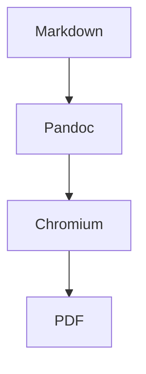

# md2pdf

Convert GitHub-flavored Markdown into clean, PDFs using:

- Pandoc
- Chromium
- GitHub Markdown CSS
- Nix Flakes

The generated PDFs are optimized for technical documentation and include:

- GitHub-style typography
- Syntax highlighting
- Automatic table of contents
- Clean page layout
- Sensible page breaks
- No browser headers or footers
- Embedded styling for reproducible output

> See the [output here](./mdtest.pdf)

---

## Features

- GitHub style Markdown rendering
- Syntax highlighting via Pandoc
- Automatic Mermaid diagram rendering (SVG)
- Automatic table of contents
- Professional PDF layout
- Works entirely through `nix run`
- No local Pandoc or Chromium installation required
- Fully self-contained flake

---

## Usage

Generate a PDF from a Markdown file:

```bash
nix run git+ssh://git@dkgiteap01/<user>/md2pdf -- document.md
```

Example:

```bash
nix run git+ssh://git@dkgiteap01/<user>/md2pdf -- secrets.md
```

Output:

```text
secrets.pdf
```

The PDF is generated next to the source Markdown file.

---

## Mermaid

Mermaid code blocks are rendered automatically using Mermaid CLI. No additional
commands or downloads are needed once the Nix dependencies are available.

````markdown

````

Diagrams are embedded as SVG images. Invalid Mermaid syntax stops the conversion.

---

## Repository Structure

```text
md2pdf/
├── flake.nix
├── run.sh
├── mermaid.lua
├── template.html
├── github-markdown.min.css
└── README.md
```

| File | Purpose |
| -------- | -------- |
| `flake.nix` | Nix flake definition |
| `run.sh` | Main conversion logic |
| `mermaid.lua` | Renders Mermaid code blocks as SVG |
| `template.html` | PDF rendering template |
| `github-markdown.min.css` | Embedded GitHub styling |
| `README.md` | Documentation |

---

## Output Pipeline

```text
Markdown
    ↓
Pandoc + Mermaid filter
    ↓
HTML
    ↓
GitHub Markdown CSS
    ↓
Chromium
    ↓
PDF
```

---
