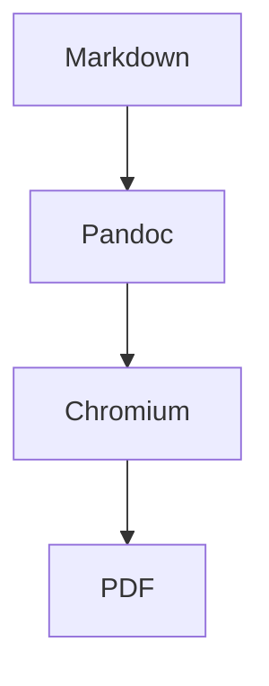

# md2pdf

Convert GitHub-flavored Markdown into clean, PDFs using:

- Pandoc
- Chromium
- GitHub Markdown CSS
- Nix Flakes

The generated PDFs are optimized for technical documentation and include:

- Four document themes with packaged fonts
- Syntax highlighting
- Automatic table of contents
- Clean page layout
- Sensible page breaks
- Page numbers without browser URL/date headers
- Embedded styling for reproducible output

> See the [output here](./mdtest.pdf)

---

## Features

- GitHub style Markdown rendering
- Syntax highlighting via Pandoc
- Automatic Mermaid diagram rendering (SVG)
- Automatic table of contents
- Professional PDF layout
- Works entirely through `nix run`
- No local Pandoc or Chromium installation required
- Fully self-contained flake

---

## Usage

Generate a PDF from a Markdown file:

```bash
nix run git+ssh://git@dkgiteap01/<user>/md2pdf -- document.md
```

Example:

```bash
nix run git+ssh://git@dkgiteap01/<user>/md2pdf -- secrets.md
```

Output:

```text
secrets.pdf
```

The PDF is generated next to the source Markdown file.

---

## Mermaid

Mermaid code blocks are rendered automatically using Mermaid CLI. No additional
commands or downloads are needed once the Nix dependencies are available.

````markdown

````

Diagrams are embedded as SVG images. Invalid Mermaid syntax stops the conversion.

---

## Repository Structure

```text
md2pdf/
├── flake.nix
├── run.sh
├── mermaid.lua
├── template.html
├── github-markdown.min.css
└── README.md
```

| File | Purpose |
| -------- | -------- |
| `flake.nix` | Nix flake definition |
| `run.sh` | Main conversion logic |
| `mermaid.lua` | Renders Mermaid code blocks as SVG |
| `template.html` | PDF rendering template |
| `github-markdown.min.css` | Embedded GitHub styling |
| `README.md` | Documentation |

---

## Output Pipeline

```text
Markdown
    ↓
Pandoc + Mermaid filter
    ↓
HTML
    ↓
GitHub Markdown CSS
    ↓
Chromium
    ↓
PDF
```

---

## Themes and layout

```bash
nix run . -- showcase.md
nix run . -- showcase.md --theme academic
nix run . -- showcase.md --theme professional --pagination sections
nix run . -- showcase.md --theme minimal --pagination flow --no-toc --no-footer
```

Themes: `technical` (default), `academic`, `professional`, `minimal`.

Pagination: `smart` (default) starts H1 headings on new pages and tries to keep short leaf subsections together. `chapters` starts H1 headings on new pages; `sections`
also starts H2 headings on new pages, except immediately after H1; `flow`
uses natural page breaks. All modes keep headings with following content.

Optional YAML metadata:

```yaml
---
title: Linux Fleet Management
subtitle: Architecture and implementation
author: Platform Engineering
version: 2.0
date: November 2026
cover: true
toc: true
theme: technical
pagination: chapters
---
```

CLI theme and pagination override metadata. Use `toc: false` or `--no-toc`
to omit the contents page. The first H1 supplies the title when frontmatter omits it. Cover pages require a title or H1. Page numbers can be removed with `--no-footer`. TOC page numbers are resolved from the first PDF rendering pass.
GitHub alerts and language-labelled fenced code blocks are styled automatically.
Local image paths are resolved relative to the Markdown file.

Mermaid sizes are selected automatically from the rendered SVG dimensions.
Use a fenced language of `mermaid-small`, `mermaid-normal`, `mermaid-large`,
or `mermaid-full` to override the maximum height (65, 110, 180 or 215 mm).
The document-wide `mermaid-size` metadata accepts the same sizes or `auto`.
All sizes preserve aspect ratio and do not upscale beyond the natural image size.
Smart grouping is best-effort: long sections and tables can still span pages.

## Combined documents and navigation

```bash
md2pdf docs/*.md -o documentation.pdf
md2pdf docs/01-intro.md docs/02-architecture.md -o documentation.pdf --number-sections --metadata-file document.yaml
```

Inputs are combined in argument order into one PDF with a shared contents page,
cover by default, footer and hierarchical PDF bookmarks. Use `-o` for
multiple inputs. Section numbering is opt-in; avoid it if headings already
contain manual numbers. The metadata file accepts the usual Pandoc YAML keys,
including `title`, `author`, `subject`, `keywords`, `cover` and `theme`.
When input frontmatter conflicts, Pandoc's combined metadata rules apply.
Image lookup searches input directories in order; use unique relative asset
paths to avoid ambiguity. Links to other Markdown files are not rewritten.
Bookmarks use measured heading destinations, with first-pass positions as a
fallback when Chromium omits final named destinations.

### Defaults without configuration

No YAML file is required. Combined documents get a cover and a project title
from the common input directory (the parent of `docs`, `doc` or `documentation`),
or the output filename when inputs use different directories. Single documents
retain the first H1 title fallback and no cover by default. Explicit title and
cover metadata still take precedence over automatic defaults; `--cover` and
`--no-cover` override cover metadata. The technical theme, smart pagination,
automatic Mermaid sizing, TOC, bookmarks and footer are enabled by default.
Section numbering remains opt-in to avoid duplicating existing chapter numbers.
