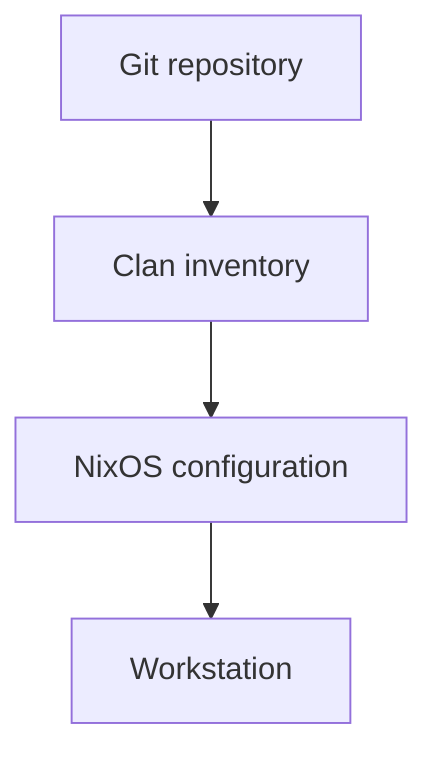

# Overview

A reproducible Linux platform built with declarative configuration and GitOps.

## Configuration

```nix
{ pkgs, ... }:
{
  services.openssh.enable = true;
  environment.systemPackages = [ pkgs.git ];
}
```

> [!WARNING]
> Disk provisioning overwrites existing partitions.

| Component | Technology | Purpose |
| --- | --- | --- |
| Fleet | Clan | Provisioning |
| OS | NixOS | Configuration |
| Updates | Comin | GitOps |
| Inventory | NetBox | Asset management |

# Architecture

## Data flow



The inventory describes the managed machines.
